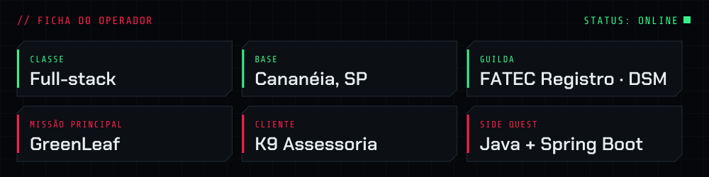
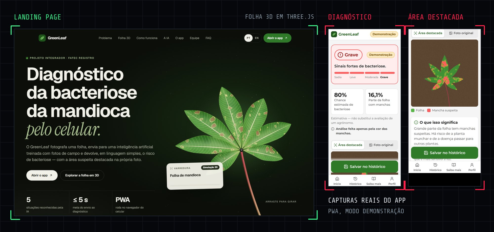
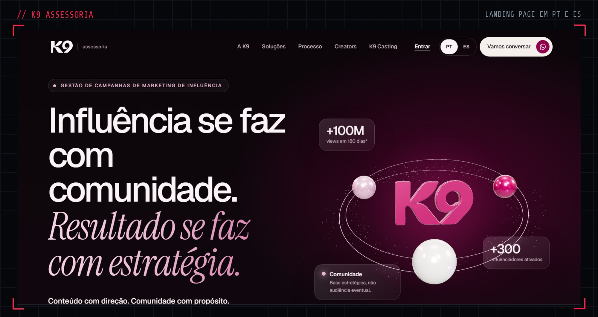
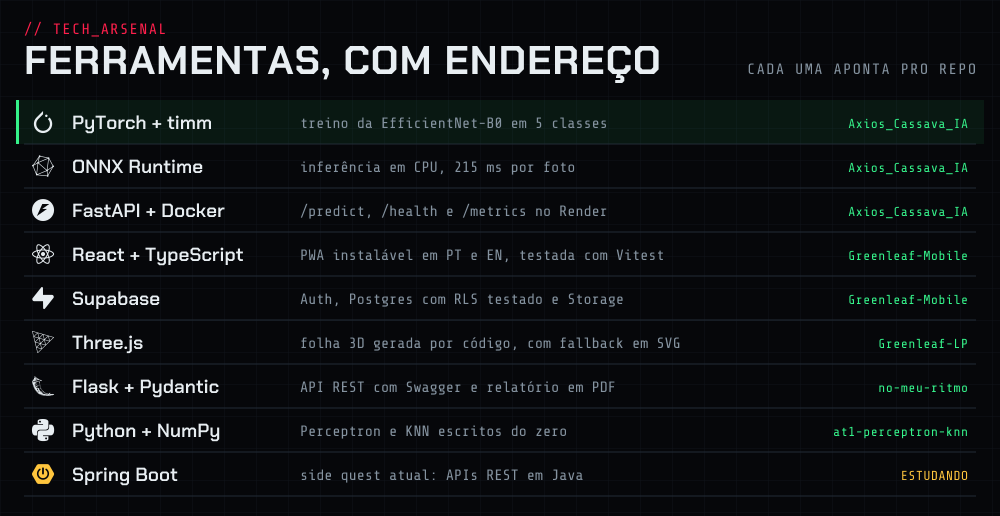
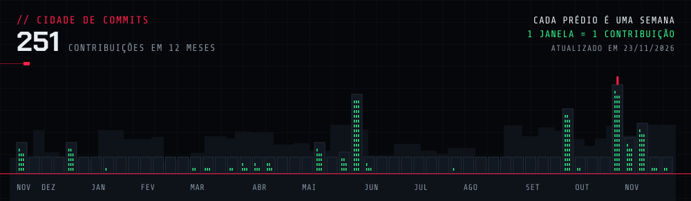

 

Sou de Cananéia, no litoral sul de São Paulo, e escrevo software pensando em quem nunca vai abrir um terminal: o produtor que fotografa uma folha no meio da roça, com sol batendo na tela e sinal fraco. Estudo Desenvolvimento de Software Multiplataforma na **FATEC Registro** e gosto de pegar um problema do começo ao fim: treinar o modelo, colocar a API no ar e desenhar a tela.

A bacteriose pode reduzir em até 70% o peso das raízes da mandioca, e o diagnóstico ainda depende do olho de quem planta. O **GreenLeaf** analisa a foto de uma folha e responde em linguagem simples, com a área suspeita destacada na própria imagem. Os requisitos saíram de uma entrevista com um produtor de Registro. Projeto Integrador da FATEC.

  

 

**K9 Assessoria.** Site da agência de marketing de influência, em React, TypeScript e Vite, com português e espanhol no mesmo build. Para a mesma agência, desenvolvo também o K9 Casting, sistema interno de CRM automatizado com IA.

<b>ls ./side-quests</b>

 

Projetos menores, de aula ou de curiosidade, que ensinaram alguma coisa no caminho.

| Projeto | O que faz | Stack |
| :--- | :--- | :--- |
| [Eco-Commit](https://github.com/Yajoojj/Eco-Commit) | CLI que mede a energia de um script e estima o CO₂ emitido | Python, CodeCarbon, Typer |
| [No Meu Ritmo](https://no-meu-ritmo.vercel.app) | Organizador de estudos com API REST documentada e relatório em PDF | Flask, Pydantic, Supabase |
| [BookFlow API](https://github.com/Yajoojj/bookflow-api) | API de biblioteca: usuários, livros e empréstimos | Flask, SQLAlchemy, PostgreSQL |
| [Perceptron e KNN](https://github.com/Yajoojj/at1-perceptron-knn) | Fraude, churn e recomendação implementados do zero | Python, NumPy |

